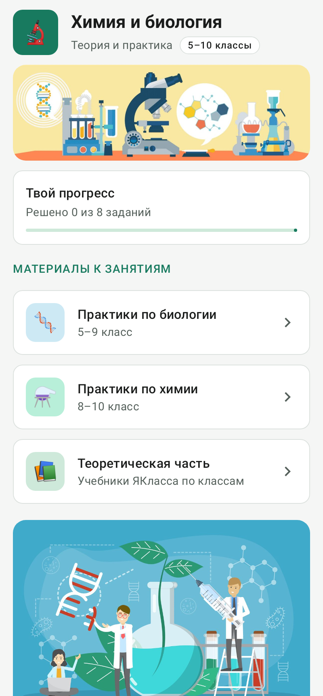
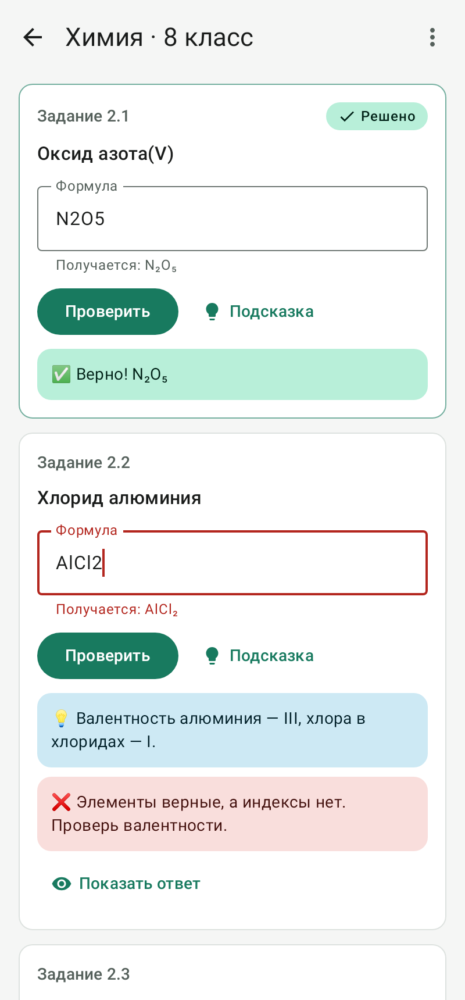
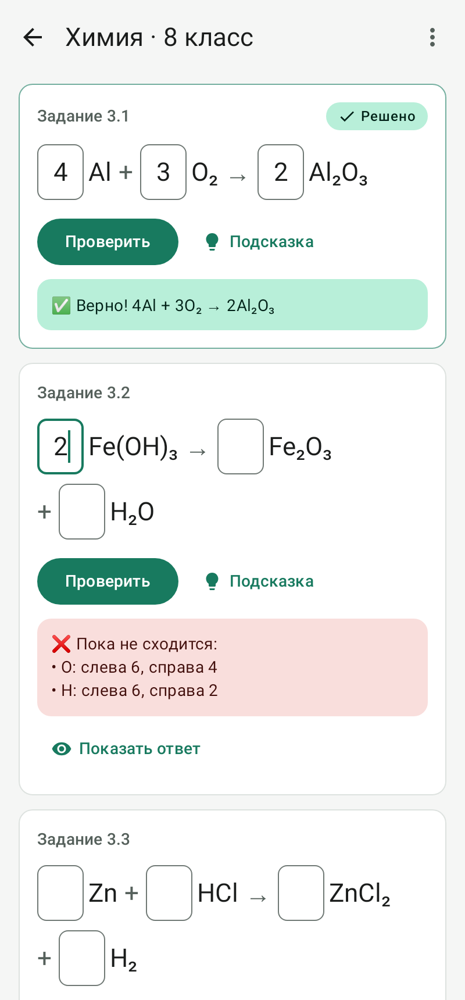

# Простая химия: Android-приложение

Приложение сделано по сайту «Простая химия с Ириной»: практики по химии и биологии для 5–10 классов.
Код на Kotlin, интерфейс на Jetpack Compose.

<p>
  
  
  
</p>

## Что умеет и чем лучше сайта

| На сайте | В приложении |
|---|---|
| Задания только текстом | Формулы и уравнения **проверяются сразу**, с объяснением ошибки («O: слева 6, справа 4») |
| Нет подсказок | Кнопки «Подсказка» и «Показать ответ» у каждого задания |
| Ответ на теорию одним полем | Отдельное поле на каждый вопрос, **черновик сохраняется сам** |
| Имя вводится каждый раз | Имя и класс запоминаются |
| Нет прогресса | Отметки «Решено» и общий прогресс на главном экране |
| Ссылки на 9 и 10 класс химии вели на несуществующие страницы | Вместо них «Задания скоро появятся» |
| Только светлая тема | Светлая и тёмная тема, работает без интернета |

Ответы на вопросы по теории уходят в ту же форму Formspree, что и на сайте, поэтому приходят учителю туда же, куда и раньше.

## Как открыть проект

1. Установите [Android Studio](https://developer.android.com/studio).
2. **File → Open** → выберите папку `android` (именно её, а не весь репозиторий).
3. Подождите, пока Android Studio скачает всё нужное (внизу окна идёт синхронизация Gradle, в первый раз 5–10 минут).
4. Подключите телефон с включённой «Отладкой по USB» (или создайте эмулятор в **Device Manager**) и нажмите зелёную кнопку ▶ **Run**.

## Где что лежит

```
android/
├── app/src/main/java/ru/prostayahimiya/app/
│   ├── data/Content.kt        ← ВСЕ задания, вопросы и ссылки. Новые практики добавляются здесь
│   ├── chem/                  ← разбор формул и проверка уравнений
│   ├── ui/home/               ← главный экран
│   ├── ui/subject/            ← список классов
│   ├── ui/practice/           ← экран практики с заданиями
│   ├── ui/theory/             ← ссылки на ЯКласс
│   └── ui/theme/Theme.kt      ← цвета приложения
├── app/src/test/              ← тесты: проверяют, что все ответы в Content.kt правильные
├── app/build.gradle.kts       ← версия приложения, имя пакета, подпись
└── store/                     ← иконка, скриншоты и тексты для RuStore
```

### Как добавить практику для нового класса

Откройте `data/Content.kt`, скопируйте блок `chemistry8` и поменяйте тексты. Например, для 9 класса:

```kotlin
private val chemistry9 = Practice(
    id = "chem9",                       // у каждой практики свой id
    title = "Практика по химии",
    questions = listOf(
        Question("chem9-q1", "Что такое электролитическая диссоциация?"),
    ),
    formulas = listOf(
        FormulaTask("chem9-f1", "сульфат натрия", "Na2SO4", "Натрий — I, кислотный остаток SO₄ — II."),
    ),
    equations = listOf(
        EquationTask("chem9-e1", Equation(listOf("H2", "O2"), listOf("H2O")), listOf(2, 1, 2), "Начни с кислорода."),
    ),
)
```

Потом укажите её у класса: `Grade(Subject.CHEMISTRY, 9, theoryUrl = "...", practice = chemistry9)`.

Чтобы проверить, нет ли ошибки в ответах, запустите тесты: в Android Studio нажмите правой кнопкой на папку `app/src/test` → **Run Tests**. Если в каком-то уравнении коэффициенты неправильные, тест покажет, в каком именно.

## Сборка для RuStore

### 1. Создайте ключ подписи (один раз)

В Android Studio: **Build → Generate Signed App Bundle or APK → APK → Create new…**
Сохраните файл, например, как `android/prostaya-himiya.jks`, придумайте пароли и alias `prostaya-himiya`.

> ⚠️ **Сохраните файл `.jks` и пароли в надёжном месте** (флешка, облако). Без них вы не сможете выпускать обновления
> приложения в RuStore. В Git ключ не попадёт, это запрещено в `.gitignore`.

### 2. Настройте подпись

Скопируйте `keystore.properties.example` в `keystore.properties` (в той же папке `android`) и впишите свои пароли.

### 3. Соберите APK

В Android Studio: **Build → Generate Signed App Bundle or APK** (с вашим ключом), или в терминале в папке `android`:

```
gradlew assembleRelease        (Windows)
./gradlew assembleRelease      (macOS / Linux)
```

Готовый файл: `app/build/outputs/apk/release/app-release.apk`. Его и загружаете в RuStore.

### 4. Перед каждым обновлением

В `app/build.gradle.kts` увеличьте `versionCode` на 1 (было 1, стало 2) и поменяйте `versionName` (например, `"1.1"`).
RuStore не примет новую версию с тем же `versionCode`.

## Публикация в RuStore: чек-лист

- [ ] Зарегистрироваться в [консоли RuStore](https://console.rustore.ru) (вход через VK ID) и пройти проверку разработчика
- [ ] Создать приложение, имя пакета: `ru.prostayahimiya.app` (если хотите другое, поменяйте `applicationId` в `app/build.gradle.kts` **до** первой загрузки, потом уже нельзя)
- [ ] Загрузить подписанный `app-release.apk`
- [ ] Иконка 512×512: `store/icon-512.png`
- [ ] Скриншоты: `store/screenshots/` (или снимите свои с телефона)
- [ ] Название и описание: готовый текст в `store/rustore-opisanie.md`
- [ ] Категория «Образование», возрастной рейтинг 0+ или 6+
- [ ] Политика конфиденциальности: черновик в `store/privacy-policy.md`. Её нужно выложить по ссылке (например, отдельной страницей на сайте) и указать ссылку в RuStore. Это обязательно, потому что приложение отправляет имя ученика.

## Важно проверить до публикации

- **Права на картинки.** Иллюстрации с сайта (`banner_lab.jpg`, `scientists.jpg`) похожи на картинки из фотобанка.
  Убедитесь, что лицензия разрешает использовать их в приложении, или замените их своими (положите файлы с теми же
  именами в `app/src/main/res/drawable-nodpi/`).
- **Отправка ответов.** Formspree — зарубежный сервис. Для школьного приложения в России может понадобиться российский
  сервис форм (например, Яндекс Формы), чтобы данные учеников хранились в России. Адрес отправки находится в
  `data/Content.kt` (`ANSWERS_ENDPOINT`), а сам код отправки в `data/AnswerSender.kt`.
