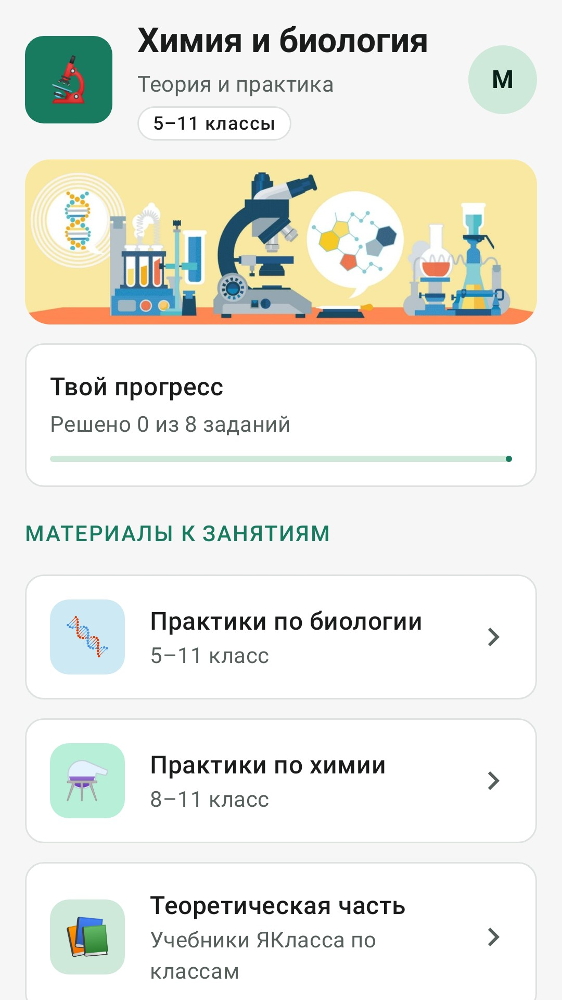
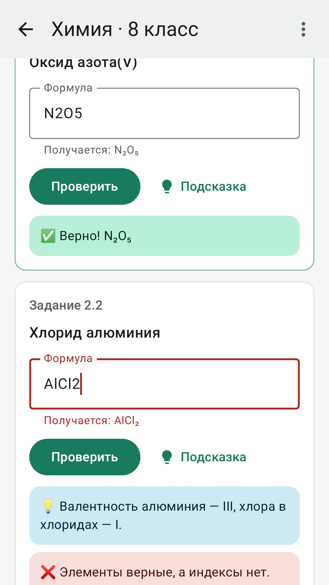
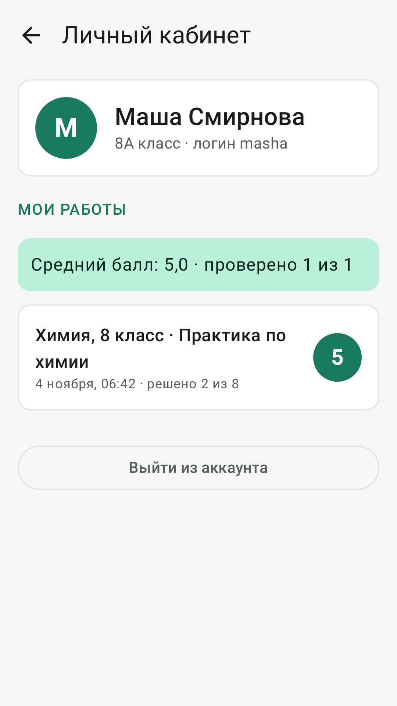
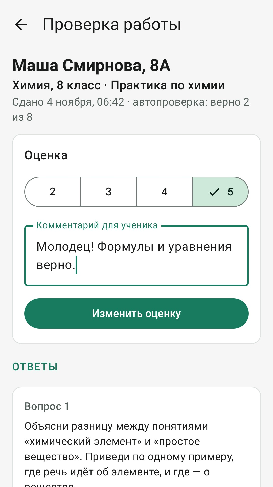

# Простая химия: Android-приложение

Приложение сделано по сайту «Простая химия с Ириной»: практики по химии и биологии для 5–11 классов.
Код на Kotlin, интерфейс на Jetpack Compose.

<p>
  
  
  
  
</p>

## Что умеет

**Ученик**
- регистрируется и входит по логину и паролю (почта не нужна);
- решает практики: формулы и уравнения **проверяются сразу**, с объяснением ошибки («O: слева 6, справа 4»),
  есть подсказки и правильные ответы;
- отвечает на вопросы по теории, черновик сохраняется сам;
- **сдаёт работу учителю** одной кнопкой;
- в **личном кабинете** видит все свои работы, ответы, оценки, комментарии учителя и средний балл.
- **не может списать:** задания нельзя скопировать, в поля ответа нельзя вставить текст, а на экране практики
  запрещены скриншоты (у учителя этих ограничений нет).

**Учитель** (панель учителя видна только ему)
- видит сданные работы, сначала непроверенные, и ответы ученика;
- **ставит оценку** от 2 до 5 и пишет комментарий;
- **создаёт и редактирует практики и задания**: вопросы, формулы, уравнения. Неправильный ответ сохранить нельзя:
  приложение само проверит, что коэффициенты уравнивают реакцию;
- может держать практику черновиком, пока не опубликует;
- видит список учеников и **сбрасывает пароль**, если ученик его забыл.

Ещё есть светлая и тёмная тема. Задания сохраняются на телефоне, поэтому решать их можно и без интернета.

## Как это устроено

```
 Телефоны учеников и учителя  ──https──►  Сервер PocketBase (папка server/)
   (это приложение)                         аккаунты, задания, работы, оценки
```

Сервер нужно один раз запустить, инструкция в [server/README.md](../server/README.md). Тот же сервер показывает и сайт с такими же возможностями, как у приложения. Для проверки на своём
компьютере хватит бесплатного запуска PocketBase на компьютере, арендовать ничего не нужно.

## Как открыть проект

1. Установите [Android Studio](https://developer.android.com/studio).
2. **File → Open** → выберите папку `android` (именно её, а не весь репозиторий).
3. Подождите, пока Android Studio скачает всё нужное (внизу окна идёт синхронизация Gradle, в первый раз 5–10 минут).
4. Создайте эмулятор в **Device Manager** и нажмите зелёную кнопку ▶ **Run**. Приложение подключится к серверу
   в интернете (`https://урокискириллом.рф`). Чтобы проверить с сервером на своём компьютере, см. server/README.md.

## Где что лежит

```
android/
├── app/src/main/java/ru/prostayahimiya/app/
│   ├── data/Repository.kt     ← вход, регистрация, загрузка заданий, сдача работ, оценки
│   ├── data/PocketBase.kt     ← связь с сервером
│   ├── data/Content.kt        ← ссылки на теорию ЯКласса и постоянные классы
│   ├── chem/                  ← разбор формул и проверка уравнений
│   ├── ui/auth/               ← вход и регистрация
│   ├── ui/home/               ← главный экран
│   ├── ui/subject/            ← список классов и практик
│   ├── ui/practice/           ← экран практики с заданиями
│   ├── ui/cabinet/            ← личный кабинет и просмотр работы (тут же учитель ставит оценку)
│   ├── ui/admin/              ← панель учителя и редактор заданий
│   ├── ui/theory/             ← ссылки на ЯКласс
│   └── ui/theme/Theme.kt      ← цвета приложения
├── app/src/test/              ← тесты проверки формул и стартовых заданий сервера
├── app/build.gradle.kts       ← АДРЕС СЕРВЕРА, версия приложения, имя пакета, подпись
└── store/                     ← иконка, скриншоты и тексты для RuStore
```

Задания теперь хранятся на сервере, и менять код, чтобы добавить практику, не нужно: учитель делает это в
«Панели учителя» → «Задания». Стартовая практика для 8 класса (с сайта) создаётся на сервере автоматически.

Тесты запускаются так: в Android Studio правой кнопкой на папку `app/src/test` → **Run Tests**.

## Сборка для RuStore

### 0. Адрес сервера

Адрес уже вписан в `app/build.gradle.kts`: `https://урокискириллом.рф` (строка `releaseServerUrl`, домен записан
в виде `xn--h1aaafbiaikhnfkx.xn--p1ai`). Сервер на нём устанавливается одной командой, см. server/README.md.

### 1. Создайте ключ подписи (один раз)

В Android Studio: **Build → Generate Signed App Bundle or APK → APK → Create new…**
Сохраните файл, например, как `android/prostaya-himiya.jks`, придумайте пароли и alias `prostaya-himiya`.

> ⚠️ **Сохраните файл `.jks` и пароли в надёжном месте** (флешка, облако). Без них вы не сможете выпускать обновления
> приложения в RuStore. В Git ключ не попадёт, это запрещено в `.gitignore`.

### 2. Настройте подпись

Скопируйте `keystore.properties.example` в `keystore.properties` (в той же папке `android`) и впишите свои пароли.

### 3. Соберите APK

В Android Studio: **Build → Generate Signed App Bundle or APK** (с вашим ключом), или в терминале в папке `android`:

```
gradlew assembleRelease        (Windows)
./gradlew assembleRelease      (macOS / Linux)
```

Готовый файл: `app/build/outputs/apk/release/app-release.apk`. Его и загружаете в RuStore.

### 4. Перед каждым обновлением

В `app/build.gradle.kts` увеличьте `versionCode` на 1 (было 1, стало 2) и поменяйте `versionName` (например, `"1.1"`).
RuStore не примет новую версию с тем же `versionCode`.

## После публикации в RuStore

1. Пришлите ссылку на страницу приложения в RuStore: её нужно вписать в `server/pb_public/js/config.js`
   (строка `rustoreUrl`), чтобы табличка на сайте стала «Скачать в RuStore», и обновить сервер.
2. Загрузите **обновление 1.1** (код версии 2): в нём исправлена шапка на узких телефонах,
   убраны подсказки и «Показать ответ», прогресс считается по сданным работам, появились чат,
   новые виды заданий (тест, пропуски, молярная масса) и картинки, ответы проверяет сервер.
   Соберите APK тем же ключом `prostaya-himiya.jks` (**Build → Generate Signed App Bundle or APK → APK →
   Choose existing…**) и в консоли RuStore: **Версии → Загрузить версию**.

История версий:

| Версия | Код версии | Что нового |
|---|---|---|
| 1.0 | 1 | Первая публикация |
| 1.1 | 2 | Исправлена шапка на узких экранах, ссылки на теорию для 10–11 классов. Убраны подсказки и «Показать ответ». Прогресс на главной — по сданным работам (одинаковый на сайте и в приложении), в практике — «Заполнено N из M». Учитель видит, сколько попыток было у ученика. Чат класса и личные сообщения учителю. Новые задания: тест, пропущенные слова, молярная масса; картинки к заданиям. Правильные ответы больше не хранятся на телефоне — ответ проверяет сервер |

## Публикация в RuStore: чек-лист

- [ ] Зарегистрироваться в [консоли RuStore](https://console.rustore.ru) (вход через VK ID) и пройти проверку разработчика
- [ ] Создать приложение, имя пакета: `ru.prostayahimiya.app` (если хотите другое, поменяйте `applicationId` в `app/build.gradle.kts` **до** первой загрузки, потом уже нельзя)
- [ ] Загрузить подписанный `app-release.apk`
- [ ] Иконка 512×512: `store/icon-512.png`
- [ ] Скриншоты: `store/screenshots/` (6 штук, 1080×1920, пропорция 9:16 — как требует RuStore)
- [ ] Название и описание: готовый текст в `store/rustore-opisanie.md`
- [ ] Категория «Образование», возрастной рейтинг 0+ или 6+
- [ ] Сервер работает по https на `урокискириллом.рф`, учителю выданы права
- [ ] Политика конфиденциальности: https://урокискириллом.рф/privacy.html (ссылка есть и в приложении, внизу экрана входа и главной)
- [ ] Для проверки RuStore может попросить тестовый аккаунт: создайте ученика, например `rustore_test`, и укажите логин и пароль в консоли

## Важно проверить до публикации

- **Права на картинки.** Иллюстрации с сайта (`banner_lab.jpg`, `scientists.jpg`) похожи на картинки из фотобанка.
  Убедитесь, что лицензия разрешает использовать их в приложении, или замените их своими (положите файлы с теми же
  именами в `app/src/main/res/drawable-nodpi/`).
- **Персональные данные.** В приложении хранятся имена учеников. Держите сервер в России (см. server/README.md)
  и опубликуйте политику конфиденциальности.
