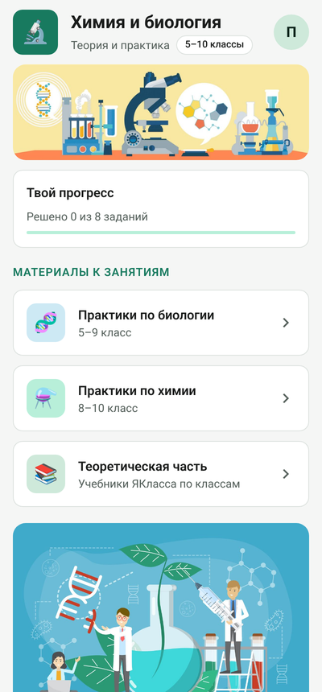
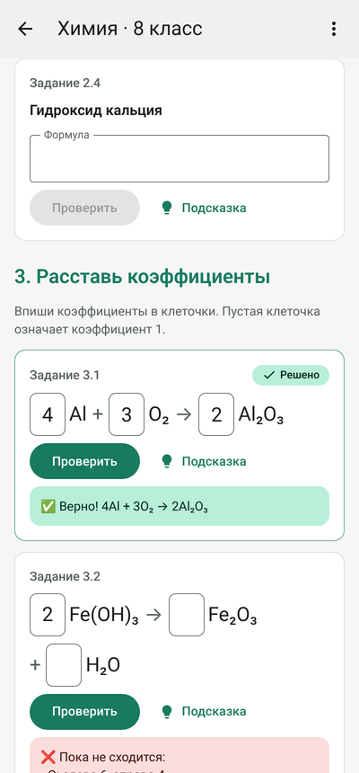
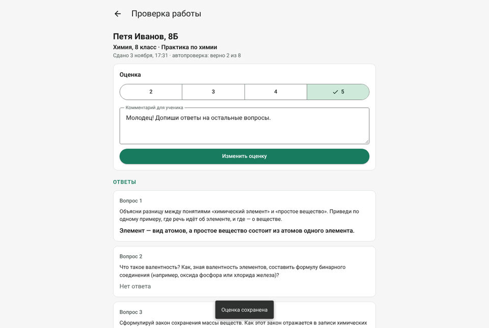

# Сервер и сайт «Простая химия»

Сервер хранит аккаунты учеников и учителя, задания, сданные работы и оценки. Им пользуются и Android-приложение,
и сайт, поэтому аккаунты, задания и оценки у них общие: можно решать на телефоне, а оценку смотреть на компьютере.
Он сделан на [PocketBase](https://pocketbase.io): это одна программа, внутри которой база данных,
вход по логину и паролю и веб-панель администратора. Писать код для сервера не нужно:

- `pb_migrations/` — описание базы: PocketBase сам создаст таблицы, правила доступа и стартовые задания при первом запуске;
- `pb_hooks/` — проверка ответов на сервере: правильные ответы ученикам не отдаются, сервер сам проверяет ответ,
  считает попытки и перепроверяет сданную работу;
- `pb_public/` — **сайт**. PocketBase сам показывает его по адресу сервера, например `https://урокискириллом.рф/`.

<p>
  
  
</p>

## Сайт

Сайт выглядит и работает так же, как приложение: вход и регистрация, практики с мгновенной проверкой
(вопросы, тесты, пропущенные слова, формулы, молярная масса, уравнения; к любому заданию можно добавить картинку), сдача работ, личный кабинет с оценками, чат класса и личные сообщения учителю, панель учителя
(проверка работ, оценки, редактор заданий, сброс паролей), светлая и тёмная тема. Открывается и на телефоне,
и на компьютере. На сайте новые сообщения в чате появляются сразу, в приложении — в течение нескольких секунд.
Ученик не может скопировать задания и вставить текст в поля ответа (у учителя этих ограничений нет).
Скриншоты на сайте запретить нельзя — это умеет только приложение.

```
pb_public/
├── index.html
├── css/app.css               ← оформление (цвета те же, что в приложении)
├── js/config.js              ← адрес сервера, если сайт лежит не на нём
├── js/chem.js                ← проверка формул и уравнений (та же логика, что в приложении)
├── js/api.js                 ← связь с сервером, вход, черновики
├── js/screens-student.js     ← экраны ученика
├── js/screens-teacher.js     ← панель учителя
├── js/screens-chat.js        ← чат класса и личные сообщения
└── js/app.js                 ← переходы между экранами
```

Сборка не нужна: это обычные файлы HTML, CSS и JavaScript.
Если захотите выложить сайт отдельно от сервера (например, на GitHub Pages), впишите адрес сервера в
`js/config.js` (`serverUrl: "https://урокискириллом.рф"`).

<p></p>

Проверено на PocketBase **v0.40.6**.

## Кто что может

| | Ученик | Учитель |
|---|---|---|
| Зарегистрироваться и войти по логину | ✅ | ✅ |
| Видеть опубликованные практики | ✅ | ✅ |
| Видеть черновики практик | ❌ | ✅ |
| Сдавать работы | ✅ | — |
| Видеть правильные ответы к заданиям | ❌ (ответ проверяет сервер) | ✅ |
| Видеть свои работы и оценки | ✅ | ✅ |
| Видеть чужие работы | ❌ | ✅ |
| Ставить оценки и комментарии | ❌ | ✅ |
| Создавать и менять практики и задания | ❌ | ✅ |
| Видеть список учеников, сбрасывать пароли | ❌ | ✅ |
| Писать в чат своего класса | ✅ | ✅ (во все классы) |
| Писать лично учителю | ✅ | — |
| Писать лично другому ученику | ❌ | ✅ (любому ученику) |
| Видеть чаты других классов и чужие личные сообщения | ❌ | ✅ |
| Удалять сообщения в чате | ❌ | ✅ |
| Менять себе имя и класс | ❌ | ✅ (ученикам) |

Эти правила проверяет сам сервер, поэтому их нельзя обойти, даже если взломать приложение.
Ученик не может сделать себя учителем: права учителя выдаёт только администратор сервера.

## Сначала: проверьте всё у себя на компьютере (бесплатно)

1. Скачайте PocketBase для своей системы со страницы
   [releases](https://github.com/pocketbase/pocketbase/releases), например `pocketbase_0.40.6_windows_amd64.zip`.
2. Распакуйте в любую папку и положите рядом папки `pb_migrations` и `pb_public` из этого репозитория:
   ```
   pocketbase-test/
   ├── pocketbase.exe
   ├── pb_migrations/
   │   └── 1762000000_init.js
   └── pb_public/
       └── index.html и остальные файлы сайта
   ```
3. Откройте в этой папке командную строку и создайте администратора:
   ```
   pocketbase.exe superuser upsert admin@example.com ВашПароль123
   ```
4. Запустите сервер:
   ```
   pocketbase.exe serve --http 0.0.0.0:8090
   ```
5. Откройте в браузере:
   - `http://127.0.0.1:8090/` — **сайт**;
   - `http://127.0.0.1:8090/_/` — веб-панель администратора, там видны все таблицы.
6. Приложение по умолчанию работает с сервером в интернете. Чтобы оно подключилось к серверу на вашем компьютере,
   добавьте в файл `android/local.properties` строку и запустите приложение заново:
   ```
   server.url=http://10.0.2.2:8090
   ```
   (`10.0.2.2` — так эмулятор видит ваш компьютер). Для **телефона** в той же Wi-Fi сети вместо `10.0.2.2` впишите
   IP компьютера (команда `ipconfig`). Когда закончите проверку, удалите эту строку.

## Как сделать учителя

1. Учитель регистрируется в приложении как обычный пользователь.
2. Администратор открывает веб-панель (`.../_/`) → **Collections → users** → находит учителя по логину.
3. Ставит галочку **isTeacher** и нажимает **Save**.
4. Учитель закрывает и снова открывает приложение. На главном экране появится «Панель учителя».

## Настоящий сервер в интернете

Нужен, чтобы приложение из RuStore работало у учеников. Данные учеников будут храниться в России.

### 1. Арендуйте сервер и домен

- **VPS** у российского хостинга (например Timeweb Cloud, Selectel, REG.RU, Yandex Cloud):
  Ubuntu 24.04, 1 ядро, 1 ГБ памяти. Обычно 200–400 ₽ в месяц.
- **Домен** — у вас уже есть `урокискириллом.рф`. В настройках DNS домена создайте **A-запись** с IP-адресом
  сервера. Домен нужен для защищённого соединения https: Android не пустит приложение на сервер без https.

### 2. Установите всё одной командой

Подключитесь к серверу: на Windows откройте **Терминал** (Пуск → «Терминал») и введите `ssh root@IP-сервера`
(IP и пароль root даст хостинг; пароль при вводе не отображается, это нормально).

Вставьте команду (правой кнопкой мыши в окне терминала), поменяв почту и пароль администратора на свои:

```bash
curl -fsSL https://raw.githubusercontent.com/Kirill898990/Python/refs/heads/main/server/install.sh | bash -s -- урокискириллом.рф ваша@почта.ru НадёжныйПароль123
```

Скрипт `install.sh` сам скачает PocketBase и файлы проекта, настроит автозапуск и https, создаст администратора.
Через пару минут (как только DNS домена укажет на сервер) откроются:
- `https://урокискириллом.рф/` — сайт;
- `https://урокискириллом.рф/_/` — панель администратора.

**Обновление** (когда в проекте что-то поменялось): запустите ту же команду без почты и пароля, ученики и оценки
сохранятся:
```bash
curl -fsSL https://raw.githubusercontent.com/Kirill898990/Python/refs/heads/main/server/install.sh | bash -s -- урокискириллом.рф
```

Если команда сработала, шаги ниже («Вручную») пропустите и переходите к пункту 4.

### Вручную: установите PocketBase

Подключитесь к серверу по SSH (хостинг даст адрес и пароль) и выполните:

```bash
sudo apt update && sudo apt install -y unzip
sudo mkdir -p /opt/pocketbase && cd /opt/pocketbase
sudo wget https://github.com/pocketbase/pocketbase/releases/download/v0.40.6/pocketbase_0.40.6_linux_amd64.zip
sudo unzip pocketbase_0.40.6_linux_amd64.zip && sudo rm pocketbase_0.40.6_linux_amd64.zip
```

Скопируйте из этого репозитория папки `pb_migrations` и `pb_public` в `/opt/pocketbase/`
(например, программой WinSCP или командой `scp -r pb_migrations pb_public root@IP-сервера:/opt/pocketbase/`). Потом создайте администратора:

```bash
sudo /opt/pocketbase/pocketbase superuser upsert ваша@почта.ru НадёжныйПароль
```

### Вручную: включите автозапуск

Создайте файл службы:

```bash
sudo nano /etc/systemd/system/pocketbase.service
```

Вставьте текст (домен `урокискириллом.рф` записан в нём в виде punycode), сохраните: Ctrl+O, Enter, Ctrl+X.

```ini
[Unit]
Description=PocketBase для приложения Простая химия
After=network.target

[Service]
Type=simple
User=root
WorkingDirectory=/opt/pocketbase
ExecStart=/opt/pocketbase/pocketbase serve xn--h1aaafbiaikhnfkx.xn--p1ai www.xn--h1aaafbiaikhnfkx.xn--p1ai
Restart=always
RestartSec=5

[Install]
WantedBy=multi-user.target
```

Запустите:

```bash
sudo ufw allow 22,80,443/tcp
sudo systemctl enable --now pocketbase
sudo systemctl status pocketbase
```

PocketBase сам получит бесплатный сертификат https (Let's Encrypt). Через минуту:
- `https://урокискириллом.рф/` — сайт для учеников и учителя;
- `https://урокискириллом.рф/_/` — веб-панель администратора.

Чтобы обновить сайт, просто замените файлы в `/opt/pocketbase/pb_public/`, перезапускать сервер не нужно.

### 4. Подключите приложение

В файле `android/app/build.gradle.kts` уже вписан адрес `https://урокискириллом.рф`
(в виде `https://xn--h1aaafbiaikhnfkx.xn--p1ai` — так в программах пишутся русские домены).
Если домен поменяется, впишите новый в строку `releaseServerUrl` и соберите приложение заново (см. `android/README.md`).

### 5. Резервные копии

В веб-панели: **Settings → Backups** → включите автоматические копии (например, каждую ночь) и время от времени
скачивайте копию себе на компьютер. Вся база — это папка `/opt/pocketbase/pb_data`.

## Как менять задания

Обычно задания меняет учитель прямо в приложении или на сайте: «Панель учителя» → «Задания». Там можно создать практику, добавить
вопросы, формулы и уравнения, а приложение не даст сохранить неправильный ответ (например, коэффициенты, которые не
уравнивают реакцию). Пока практика не опубликована, её видит только учитель.

Задания можно менять и в веб-панели PocketBase (таблицы `practices` и `tasks`), но там ответы никто не проверяет.
